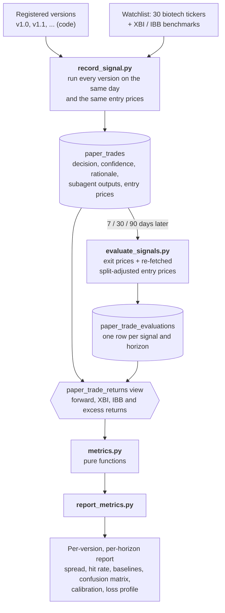

# BioSignalFoundry - Biotech Stock Decision System

This repository is a long term applied AI project focused on biotech stock decision making. The MVP is complete and the system is live: a signal-driven AI agent that answers the question:

> Should I BUY, SELL, HOLD, or AVOID a given biotech stock - and why?

## Project Philosophy
This project has a few core principles

* **Signals > Models**

    Clean, meaningful signals matter way more than fancy architectures or models

* **Reasoning > Prediction**

    The system does not predict prices. It gathers structured evidence that is currently available into decisions.

* **Deterministic before agentic**

    Deterministic pipelines and explicit signals extraction come before multi-agent systems.

* **Auditability**

    Every decision made should be explainable, traceable and debuggable.

This is not a trading bot nor financial advice.

## Current State

The MVP is shipped. Check it out here: https://biosignalfoundry-two.vercel.app The system runs end-to-end: a user asks a question about a biotech stock and receives a structured investment decision with reasoning in real time.

**Backend** (`app.py`) — FastAPI service with:
* A LangChain-based AI reasoning agent that pulls from multiple data providers
* Server-Sent Events (SSE) for real-time streaming progress to the client
* Redis caching of completed analyses to avoid redundant agent runs
* Structured JSON output validated against a typed schema

**Frontend** (`ui/`) — React + TypeScript UI with:
* Free-text input and curated suggestion prompts
* Live progress updates streamed from the backend during analysis
* Decision badge (BUY / SELL / HOLD / AVOID), confidence bar, and full reasoning display

**Data Providers**
* Alphavantage, Finnhub, FRED, SEC (via edgartools), OpenFDA, Marketstack, Massive

Detailed, provider-specific request/response examples can be found in
[`docs/api_reference/`](docs/api_reference/)

Entire repo architecture can be found in
[`docs/architecture_docs/`](docs/architecture_docs/)

## What was built (MVP)

The pipeline is intentionally minimal and linear:

> Data Sources → Signal Extraction → LLM Reasoning Agent → Structured Decision Output

For any biotech company the system returns:

* **Decision**: BUY / SELL / HOLD / AVOID
* **Confidence**: numeric score (0–100)
* **Reasoning**: short, structured explanation traceable to the underlying signals

## What this project is *NOT*

This project does **not** aim to:

* Predict short-term stock prices
* Replace financial financial advice
* Use reinforcement learning or black-box optimization

## On Backtesting

Traditional backtesting — replaying historical signal dates and evaluating decisions against past prices is intentionally not implemented in this project. This is a deliberate design decision, not an oversight.

There are four compounding reasons why proper historical backtesting is not feasible here:

1. **Hallucination risk from date-parameterized tools.** Passing a specific historical date to agent tools and asking the LLM to restrict itself to data available on that date introduces hallucination risk. LLMs are unreliable at consistently honoring such constraints when reasoning over tool outputs.

2. **APIs do not support point-in-time historical data.** Several data providers used in this project (AlphaVantage, Finnhub) return the latest available data regardless of any date argument and causes data leakage. There is no way to retrieve what the income statement or company profile looked like on an arbitrary past date through these APIs.

3. **LLM training data contamination.** Even if perfect point-in-time financial data were available, a general-purpose LLM has already seen news, filings, and market commentary about any historically significant biotech stock up to its training cutoff. The model cannot simulate the genuine uncertainty that existed on a past signal date as it has already seen how things turned out.

4. **Point-in-time financial databases are out of scope.** Services that correctly snapshot what financial data was publicly available on any given date (e.g. Bloomberg, Compustat) are expensive, proprietary, and not appropriate for an early-stage open project.

For these reasons, the evaluation strategy used here is **paper trading**: the agent makes a decision using current data, that decision is recorded with today's price as the entry point, and it is evaluated against real prices after the holding period elapses. This is honest, reproducible, and free of look-ahead bias.

## Evaluation

> **Status:** this section describes the evaluation design we are moving to.
> `scripts/record_signal.py` and `scripts/evaluate_signals.py` already record and price
> batches this way, and `scripts/report_metrics.py` prints the metrics below.

The question evaluation answers is not "how many calls were right this week?" but
**"is version B better than version A?"**. The system does not learn on its own; it only
changes when we change it (a new subagent, tool, prompt or model), so the useful
comparison is between versions, not along the calendar.

### Pipeline

Only observations (decisions and prices) are stored. Everything derived is computed at
report time.

### Versions

Every meaningful change to the system is a named version (`v1.0`, `v1.1`, ...), for
example adding a subagent or a tool, or changing a prompt or the LLM. A version is a
**configuration** (enabled subagents and tools, prompts, LLM provider and model), registered
with a label and a description. The git SHA and prompt hashes are recorded as metadata, but
the label is the identifier, so the same codebase can run any registered version.

### Parallel evaluation

Instead of running paper trading on a weekly schedule, we evaluate versions in **parallel
batches**:

1. Pick a signal date and run every version to be compared against the same watchlist on
   that day, so all versions share the same entry prices and the same market conditions.
2. Score each signal at several horizons (**7, 30 and 90 days**) as they mature, so short
   horizons give early feedback while the 90-day results complete in the background.
3. Repeat for a few batches (for example monthly), since one batch is a single market
   window and the stocks within it are correlated. More batches and a larger watchlist
   matter more than more frequent runs.

Because versions are compared on the same dates and tickers, differences can be read
stock by stock rather than only in aggregate. LLM output varies between runs, so we
measure that noise (the same version run twice) before reading small differences
between versions as real.

### Metrics

* **Benchmark return (XBI and IBB)** — each signal's forward return is compared with the
  return of the XBI (equal-weighted biotech ETF) and IBB (cap-weighted) over the same
  window, giving an **excess return** that separates stock-picking from a sector-wide move.
* **Spread** — average forward return of BUY calls minus that of SELL/AVOID calls. The
  headline metric: a system with skill should favour stocks that outperform the ones it
  dislikes, regardless of market direction. Always reported with the BUY and SELL/AVOID
  counts.
* **Hit rate** — BUY beating the benchmark and SELL/AVOID trailing it, computed per
  horizon and per decision type. HOLD is left out of the headline number, since it is
  rewarded for the stock simply not moving.
* **Baselines** — every result is shown next to simple strategies (always-BUY, always-HOLD,
  random, the benchmark itself), with N and a confidence interval, so accuracy is never
  read in isolation.
* **Confusion matrix** — decision (BUY / HOLD / SELL+AVOID) against realised outcome
  (up / flat / down, relative to the benchmark). A diagnostic for systematic habits, such as
  never saying SELL; not used to rank versions.
* **Confidence calibration** — whether high-confidence calls do better than low-confidence ones.
* **Loss profile and drawdown** — worst single-call loss and average win versus average
  loss. Maximum drawdown is only meaningful for a simulated basket of the BUY calls over a
  holding period, so it is a later addition rather than a per-signal metric.

Derived flags such as "correct" or "excess return" are computed from stored data, not
stored as verdicts, so definitions and thresholds can change without re-running anything.

### Data stored

* **Versions:** label, description, git SHA, prompt hashes, LLM provider and model, enabled
  subagents and tools.
* **Signals:** version, ticker, signal date, decision, confidence, rationale, the agent's
  full structured output (including each subagent's output), entry price, and XBI and IBB
  prices on the signal date.
* **Evaluations (one per signal and horizon):** the price date actually used, exit price,
  and XBI and IBB exit prices.

## Roadmap

The full, phase-by-phase plan lives in [`docs/ROADMAP.md`](docs/ROADMAP.md).

* **Phase 1 — Stabilization:** persistence, CI, health checks, rate limiting, config validation (done)
* **Phase 2 — Signal Completeness:** remaining subagents, version registry, new evaluation schema and scripts (all metrics above), SEC-filing RAG (in progress)
* **Phase 3 — Scalability:** async task queue, circuit breakers, true async I/O
* **Phase 4 — Observability & Parallel Evaluation:** Langfuse tracing, metrics, cost and token tracking, then parallel multi-version evaluation runs
* **Phase 5 — ML Feedback Loop:** outcome tracking, prompt A/B testing, fine-tuning
* **Phase 6 — Trust & Product Surface:** public track record, signal-level reasoning in the UI
* **Beyond MVP:** user accounts, monitoring, AI with memory, discovery feed (unscheduled)

## Disclaimer
Nothing in this repository constitutes to financial advice or a recommendation to trade securities.

## Author
* GitHub: [@Jun909](https://github.com/Jun909)
* LinkedIn: [Jun Siang Pang](https://www.linkedin.com/in/jun-siang-pang-2640071b0/)